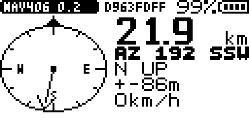
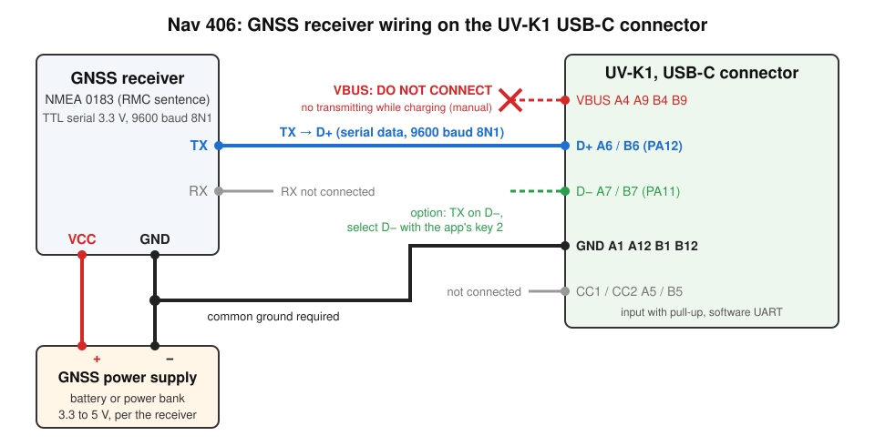

# Nav 406: walk to a 406 MHz beacon with a GPS

Nav 406 gives the distance and the direction from where you stand to a 406 MHz
distress beacon decoded by EPIRB 406. Your own position comes live from an NMEA
0183 GNSS receiver wired to the radio's USB-C connector. When you walk, the dial
turns course up and the arrow is the turn to make; standing still, it is north
up. Close in, keys 8 / 9 open Sig Finder on 121.5 / 243 MHz for the last
hundreds of metres.



(Screenshot of 0.2: since 0.6 the azimuth line is `AZ 192` alone and the
status bar no longer shows part of the ID.)

## Contents

- [Requirements](#requirements)
- [Wiring](#wiring)
- [Use](#use)
- [Screen](#screen)
- [Keys](#keys)
- [The saved target (why a manual start shows a position)](#the-saved-target-why-a-manual-start-shows-a-position)
- [Target precision](#target-precision)
- [How it works](#how-it-works)
- [Limits](#limits)
- [Versions](#versions)
- [Build and tests](#build-and-tests)
- [Credits](#credits)

## Requirements

| Item | Detail |
|---|---|
| Firmware | overlay API level 3 (`handoff`, `handoff_read`, `asset_read`); `vfo_stage` for keys 8 / 9 |
| EPIRB 406 | 3.1 or later: key 2 hands the decoded position to Nav 406 |
| Sig Finder | optional, for keys 8 / 9 |
| GNSS receiver | NMEA 0183 on a TTL serial output (3.3 V), 9600 baud 8N1 by default, with its own power supply |

## Wiring



| Signal | GNSS receiver | Radio, USB-C | Note |
|---|---|---|---|
| Serial data | TX | D+ (A6 / B6, PA12) | 9600 baud 8N1 by default; or D- (A7 / B7, PA11), selected with key 2 |
| Ground | GND | GND (A1, A12, B1, B12) | common to the receiver, its supply and the radio |
| Power | VCC | nothing | the receiver has its own battery or power bank, 3.3 to 5 V per its datasheet |
| VBUS | | **do not connect** | the radio's manual forbids transmitting while charging |
| Receiver RX | RX | not connected | read only |
| CC1 / CC2 | | not connected | |

- **Serial access**: 9600 baud 8N1 by default; key 1 cycles 4800, 9600, 19200,
  38400, 57600 and 115200 baud. TTL level 3.3 V.
- **NMEA 0183**: the RMC sentence (status, position, speed and course over
  ground) from any talker: GP, GN, GL, GA, BD.
- **Measure the receiver's TX before connecting**: it must idle at 3.3 V.
  PA11 and PA12 are not documented as 5 V tolerant.
- **USB cable colours are not reliable.** Check D+ with a meter (continuity to
  pin A6 / B6 of the plug), or try it: with the receiver's TX on a wire, Nav
  406 shows `GPS NO FIX` or a speed within a few seconds on the right pin, and
  `GPS NO DATA` on the wrong one; key 2 switches the pin, MENU shows which one
  is selected.

## Use

1. Wire and power the GNSS receiver (see above).
2. In **EPIRB 406**, select a decoded message that has a position, press **2**,
   then **MENU** to confirm. Nav 406 opens with that position and the beacon ID.
3. Walk. The screen follows each RMC sentence, once a second.
4. Close in, or once inside the uncertainty radius, press **8** (121.5 MHz) or
   **9** (243 MHz): Sig Finder opens on the homing frequency. Its EXIT gives the
   VFO back and launches Nav 406 again, target kept.
5. **EXIT** goes back to EPIRB 406, for a fresher decode of a drifting beacon.

Nav 406 can also be opened from the Apps menu: it then shows the last saved
target (see [The saved target](#the-saved-target-why-a-manual-start-shows-a-position)).

## Screen

The left half is GeoNav's dial with an arrow from the centre:

- **Course up** when you walk (2 km/h or more): the top index is where you are
  walking, from the GPS course over ground, and the arrow is the turn to make.
  No letters on the dial.
- **North up** when you stand still, with the E, S, W letters: the arrow is the
  azimuth, to use with a pocket compass.

| Right column | Content |
|---|---|
| Big digits, `m` or `km` | distance: metres below 1 km, then km with one decimal, then whole km |
| `AZ 192` | azimuth to the target, whole degrees |
| `AHEAD`, `L 40`, `R 120` | the turn when walking (`AHEAD` within 15 degrees); `N UP` when standing still |
| `+-86m` | the target's uncertainty (see [Target precision](#target-precision)) |
| `5km/h` | GPS speed over ground |

Status bar: `NAV406` and the version, the battery.

Other states, full width:

| Screen | Meaning |
|---|---|
| `NO TARGET` / `EPIRB 406: KEY 2` | no saved target: get one from EPIRB 406 |
| `TARGET SAVED` | a target, but no usable GPS position yet |
| `GPS NO DATA` | no RMC on the selected pin for 3 s: wiring, power, baud rate or pin (MENU shows them) |
| `GPS NO FIX` | RMC received, but the receiver has no fix yet (status `V`) |

**MENU** opens the help page: the current GPS settings in bold on the first line
(`GPS 9600 8N1 D+`: baud rate, 8N1, pin), the beacon ID (`ID 9C7FEC2AACD3591`,
see [The saved target](#the-saved-target-why-a-manual-start-shows-a-position)),
then the keys. Keys 1 and 2 still work
on this page, so a change shows at once. MENU or EXIT closes it.

## Keys

| Key | Action |
|---|---|
| 8 | Sig Finder on 121.5 MHz AM narrow (the VFO is staged; Sig Finder gives it back on EXIT and launches Nav 406 again) |
| 9 | Sig Finder on 243 MHz AM wide (same) |
| 1 | Baud rate: 4800, 9600, 19200, 38400, 57600, 115200 (saved) |
| 2 | Receiver pin: D+ or D- (saved) |
| 0 | Forget the target (saved): the screen shows `NO TARGET` |
| MENU | Help page with the current settings (baud rate, 8N1, pin); MENU again closes it |
| EXIT | On the help page: close it. Otherwise: Back to EPIRB 406 when a hand-off opened Nav 406 (from EPIRB 406, or Sig Finder coming back); quit when it was opened from the Apps menu |

## The saved target (why a manual start shows a position)

Nav 406 saves the target in its own app configuration, so it survives a round
trip to Sig Finder, a launch from the Apps menu and a power cycle.

**What is saved**: 16 bytes, the most the loader keeps for an app
(`APP_CONFIG_LOCAL_MAX`, `App/apps/app_config_proxy.h`):

```c
typedef struct {
    uint8_t magic, baud, pin, hasTarget;
    int32_t lat, lon;          /* target, centi-arcseconds, N and E positive */
    char    id[4];             /* last 4 characters of the beacon ID          */
} cfg_t;                       /* 16 bytes; a static assert keeps it so       */
```

**Where**: `cfg_save()` only stages the bytes in RAM. When the app returns, the
loader writes them into the app's slot in the radio's external SPI flash
(PY25Q16), in a config area tagged with the app's name
(`App/apps/app_overlay.c`, `app_cfg_save` and the commit after the app). The
tag means another app installed in the same slot does not inherit them, and
the area is kept when Nav 406 is reinstalled over itself (`APP_SlotErase`).

**When it is written**: when a target arrives from EPIRB 406, and when keys 0,
1 or 2 change something.

**At launch**, `cfg_load()` reads the 16 bytes back, then `handoff_read()` says
how the app was opened:

| Opened from | `handoff_read()` | Target used |
|---|---|---|
| EPIRB 406, key 2 | 24 bytes: latitude, longitude, ID | the new one, saved at once |
| Sig Finder coming back | 0 bytes | the saved one |
| Apps menu or a shortcut | -1 | the saved one |

So a manual start shows the last target handed over by EPIRB 406, however old.

**The beacon ID**: the whole ID (15 hex characters) is kept in RAM when EPIRB
406 hands it over, and shown on the help page (MENU). Only its last 4
characters fit in the 16 saved bytes: after a round trip to Sig Finder or a
launch from the Apps menu, the help page shows those 4 (`ID FDFF`). EPIRB 406
and QR Map show the whole ID.
**Nav 406 does not store when the target was decoded**: the radio has no
reliable clock. For a beacon that may move (a drifting EPIRB at sea), refresh
the position in EPIRB 406 before relying on it. Key 0 forgets the target; the
coordinates stay in flash, marked unused, until the next target overwrites
them.

## Target precision

A 406 MHz beacon position is coarse unless the long message carried the fine
offsets. The coarse grid depends on the protocol: 15' for the standard location
protocols, 2' for the national ones, 4' for the user location ones; the fine
offsets come in 4 s steps. The hand-off carries only the position, so Nav 406
infers the precision from it:

| Position on the grid of | Taken as | Radius shown |
|---|---|---|
| 15' (latitude and longitude) | coarse, standard location | `+-19.5km` |
| 4' | coarse, user location | `+-5.2km` |
| 2' | coarse, national location | `+-2.6km` |
| none of them | fine, 4 s steps | `+-86m` |

The radius is half the grid diagonal, in latitude units. A fine position that
falls exactly on a 2' grid in both latitude and longitude (about 1 in 900) is
shown as coarse: the error is on the safe side. With a coarse position, Nav 406
takes you to the area; Sig Finder does the rest.

## How it works

- **GNSS input**: a software UART on the USB pins. The app stops the USB clock,
  turns PA12 (D+) or PA11 (D-) into an input with pull-up, and samples each
  byte at mid-bit on the SysTick counter with IRQs masked from the start bit to
  the stop bit (about 1 ms at 9600 baud). Pins and USB clock are restored on
  exit, so the PC link works again afterwards.
- **NMEA**: XOR checksum checked byte by byte. A checked RMC is parsed as soon
  as its LF arrives, in a single buffer: well within a byte time; at worst the
  first byte of the next sentence (GGA, VTG..., not read here) is missed.
  Coordinates go straight to centi-arcseconds (1e-5 minute = 3/50 cas).
- **Units**: centi-arcseconds throughout, the unit of EPIRB 406, QR Map and the
  radiosonde apps: no conversion of the target.
- **Navigation**: GeoNav's equirectangular distance and arctangent
  approximation, accurate for the tens of km of a homing. Host test against
  haversine: within 0.4 % from 30 m to 89 km, azimuth within 1 degree.
- **Keys and display**: a receiver at 9600 baud sends its sentences in one
  burst (about 600 ms a second for the GN-801), and the app cannot read the
  keypad while it samples bytes. Nav 406 needs only the RMC: once it is parsed,
  the line is ignored for 700 ms and the keys are read every 10 ms; the rest of
  the second, they are read in the quiet gaps (20 ms without a start bit). The
  screen is drawn on each new RMC, on a key, and at least once a second, never
  in the middle of a byte. While the screen saver shows (`APP_KEY_SAVER`), nothing is
  drawn; `APP_KEY_WAKE` redraws.
- **Read-only assets**: the texts, the 16-point direction table, the Q1000
  cosine table and both dial bitmaps (`gen_assets.py`), outside the 4 KiB
  overlay.

## Limits

- **One app at a time**: no 406 MHz burst is decoded while Nav 406 runs. Go
  back to EPIRB 406 (EXIT) to refresh a drifting beacon.
- **No compass**: the turn needs walking speed (2 km/h or more); standing still,
  use the azimuth with a pocket compass.
- **USB-C taken by the receiver**: no PC link and no charging while the app
  runs. The screen can still be watched from a PC through the programming cable
  on the K-plug (K5Viewer at 38400 baud).
- **No age of the target** (see [The saved target](#the-saved-target-why-a-manual-start-shows-a-position)).
- **The whole beacon ID only right after EPIRB 406**: the saved config (16
  bytes) keeps its last 4 characters.
- **No range ring or target dot** on the dial: the distance is in the big
  digits.

## Versions

| Version | Change |
|---|---|
| 0.1 | Target from EPIRB 406 (key 2), live RMC from USB-C, distance and azimuth in text, turn against the course over ground, precision from the grid, Sig Finder on 8 / 9 |
| 0.2 | GeoNav's dial: course up when walking, north up when standing still; texts, tables and bitmaps in assets |
| 0.3 | Screen saver keys handled again: 0.2 took `APP_KEY_SAVER` for a key press and relit the backlight at each timeout, so the screen blinked |
| 0.4 | Saved config cut to the 16 bytes the loader keeps (it was 28: the ID was truncated to its first 4 characters on a manual start); the last 4 ID characters are kept; static assert on the size |
| 0.5 | MENU help page with the current settings (baud rate, 8N1, pin); keys read every 10 ms for 700 ms after each RMC: before, a short press (EXIT) was lost when it fell in a burst and had to be held; the pin left the `GPS NO DATA` line (it is on the help page) |
| 0.6 | The beacon ID in full on the help page after a hand-off (its last 4 characters otherwise); for room, the 16-point direction after the azimuth, the ID tail in the status bar and the radius on the `TARGET SAVED` screen are gone |

## Build and tests

Build with the repository's overlay script (Docker image `uvk1-uvk5v3`):

```sh
./compile-app.sh nav406        # -> build/Apps/Nav406.app
```

0.6: 4036 of 4096 bytes of code and data, plus 1312 bytes of assets.

Host tests: `test/run_tests.sh` (needs a host C compiler and python3) builds
the app source on a stub API: RMC to centi-arcseconds, distance and azimuth
against haversine, the four precision grids, the hand-off cases (EPIRB 406,
Sig Finder, Apps menu, out of range), the 16-byte save and reload, the screen
texts, the screen saver keys and the help page (64 checks). With `FB_WALK` and
`FB_STOP` set to file paths, it also writes the dial's frame buffer.

## Credits

The navigation (`navigation()`, `bearing()`, `isqrt32()`), the cosine table and
the dial come from **GeoNav** by Armel F4HWN (Apache-2.0). The software UART is
built on CW USB's use of the USB pins.

## License

Apache License 2.0, like the rest of this repository (see `LICENSE` at the
root). The navigation, the cosine table and the dial are adapted from GeoNav
(Armel F4HWN, Apache-2.0); see [Credits](#credits).
