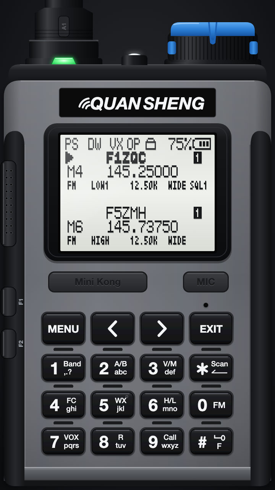
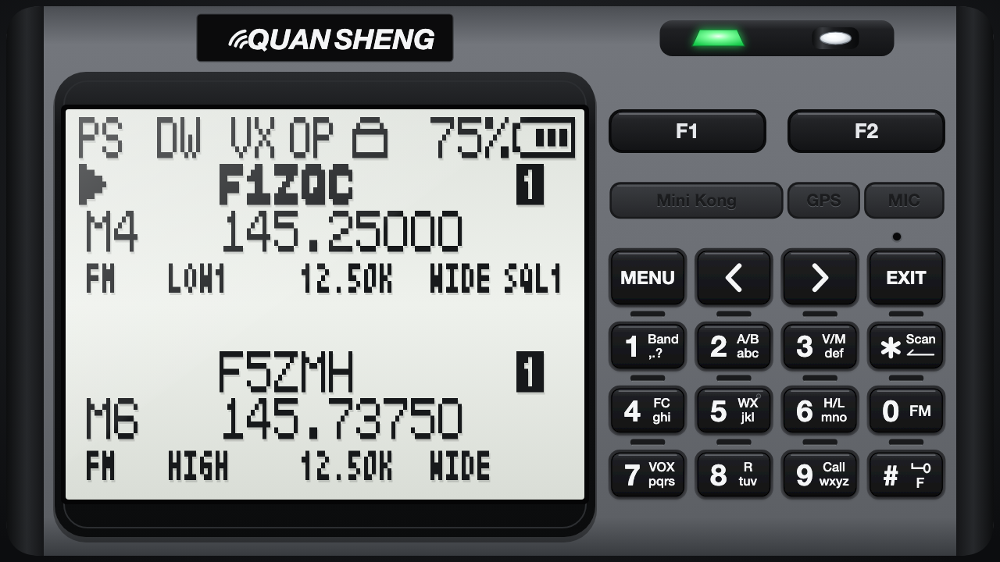
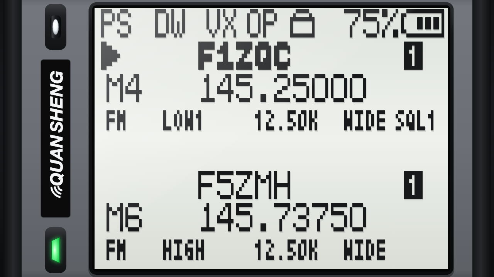

# Tab5 K1Viewer

K1Viewer turns an M5Stack Tab5 into a remote touchscreen display for a
UV-K1/K5V3 running the Fusion firmware. The Tab5 receives the screen stream
through its USB-A host port and shows a full-size UV-K1: the radio's 128 × 64
display replaces the screen of the drawing, the RX/TX LED and the white torch
follow the radio, and the drawn keypad works as a touch keypad. Turn the Tab5
on its side for a large screen, with or without the keypad.



This project targets early Tab5 units fitted with an ESP32-P4 revision 1.x. Do
not flash this image on ESP32-P4 revision 3.x hardware.

## Requirements

- M5Stack Tab5 with an ESP32-P4 revision 1.x
- USB-C data cable for flashing
- USB-A to USB-C data cable, or a K-plug programming cable using a supported
  CH340/CH341, CP210x, PL2303, FT231/FT232 or CDC-ACM USB-to-UART converter
- Fusion firmware from the `feature_update_v7` branch installed on the K1
- Optional: M5Stack Mini GPS/BDS Unit (U032) or Unit GPS v1.1 (U032-V11) on
  the Tab5 Grove port

## Build

The build script automatically installs ESP-IDF 5.5.6 and the ESP32-P4
toolchain under `~/Library/Caches/tab5-k1viewer`. The first build requires an
Internet connection. Later builds reuse the installed toolchain and compiled
dependencies.

From the repository root, run:

```sh
cd tools/m5stack/tab5-k1viewer
./build-local.sh
```

The script verifies that both the bootloader and application target ESP32-P4
revisions 1.0 through 1.99. The flash-ready image is written to:

```text
dist/tab5-k1viewer-esp32p4-rev1.bin
```

This is a merged image containing the bootloader, partition table, and
application. It must be flashed at address `0x0`.

## Flash with ESP Launchpad

1. Connect the Tab5 USB-C port to the computer with a data cable.
2. Press and hold **Reset** for approximately two seconds.
3. Release **Reset** when the internal green LED starts flashing rapidly. The
   Tab5 is now in download mode.
4. Open [ESP Launchpad](https://espressif.github.io/esp-launchpad/) in a Web
   Serial-compatible browser such as Chrome or Edge.
5. Select the **DIY** tab.
6. Click **Connect** and select the Tab5 serial port.
7. In **Flash Address**, replace the default value with **`0x0`**.
8. Click **Browse files** and select
   `dist/tab5-k1viewer-esp32p4-rev1.bin`.
9. Click **Program** and wait for the flash operation to complete.
10. Restart the Tab5 after flashing has finished.

> Do not keep ESP Launchpad's default `0x1000` address. This merged image must
> be written at `0x0`.

## Connect the K1

After restarting, connect the Tab5 USB-A host port either to the K1 USB-C port
with a data cable or to the K1 accessory connector with a supported K-plug
programming cable. K-plug communication is fixed at 38400 baud. Do not use the
Tab5 USB-C programming port for either connection.

Until a radio is detected, the Tab5 shows a black screen asking to connect the
UV-K1, with the author, the GPL license and the application version at the
bottom. Its radio drawing breathes slowly and shows, in turn, the USB-C cable
and the K-plug programming cable, with the matching message.
The version is set by `project()` in `CMakeLists.txt`. It fades out to the radio as soon as the K1 is plugged in, and comes
back if the cable is removed. While the radio is in deep sleep, its screen
darkens as if the backlight were off.

To save the battery, the Tab5 backlight fades down to 10 % as soon as the radio
enters deep sleep, like its own backlight, and comes back to the level chosen
on the plate when it wakes up.
Without a radio, it fades down after 2 minutes without a touch on the screen,
and a touch brings it back (`BACKLIGHT_*` at the top of `main/main.c`).

The battery charges from the USB-C port only while the Tab5 is on: the viewer
enables the charger at start-up, and it stays off when the Tab5 is switched off.

When the flashlight of the radio is on, the torch between the antenna and the
knob lights up and casts a beam upwards. It follows the real LED, so the blink
and SOS modes show too. This needs a K1 firmware that reports the flashlight in
the viewer stream (bit 3 of the frame flags, `feature_update_v7` branch).

## GPS position

Plug the M5Stack Mini GPS/BDS Unit (U032) or Unit GPS v1.1 (U032-V11) directly
into the Tab5 Grove Port.A. The Tab5 powers the port and automatically detects
the older unit at 9600 baud or the v1.1 unit at 115200 baud. It also tries
common alternative rates retained by a unit configured elsewhere. Valid RMC
NMEA sentences (`GNRMC`, `GPRMC`, and other talker prefixes) are accepted, and
no GPS setting is needed in K1Viewer. Restart the Tab5 after replacing or
reconfiguring the GPS unit so that its rate is detected again.

While the K1 is connected over USB, every valid fix is forwarded to the radio.
The Fusion firmware keeps it in RAM for 15 seconds: **APRS TX** uses the latest
fix for each manual or timed transmission, and **GeoNav** uses it as its home
position when opened. If reception is lost, both applications automatically
fall back to the position saved in **APRS Edit**. Live fixes never overwrite
that stored profile.

The module may need a clear view of the sky for its first fix. K1Viewer and the
touch controls continue to work normally when the module is absent or has no
valid fix.

In portrait and keypad landscape modes, the `Mini Kong` and `MIC` plates align
with the outer keypad edges, with a wider `GPS` plate centred between them. It
uses the same shape, finish and pressed effect as the other controls. A small
status light to the right of the `GPS` label is green after a fix, flashes blue
while the receiver searches, stays blue while only raw or incomplete NMEA data
is present, and turns red if GPS initialization fails. The light stays off when
no receiver is detected and turns off 3 seconds after the receiver is
unplugged.

Tap the `GPS` plate to open the diagnostic panel, then tap the panel to close
it. Screen-only mode has no GPS plate: hold the top-left corner to open the
panel. The same top-left long press works on the radio connection screen, so a
silent or disconnected unit can still be diagnosed.

The centred panel uses the regular interface font and two aligned columns of
explicit fields. Its `State` field shows:

- `NO DATA`: the UART receives nothing, or reception stopped for 3 seconds;
- `RAW DATA`: bytes arrive but no checksum-valid NMEA sentence is decoded;
- `NMEA`: valid NMEA is present, but no usable RMC status was seen yet;
- `SEARCH`: the receiver is running but has no position fix;
- `FIX`: an active RMC position is being forwarded to the K1;
- `ERROR`: the Grove power or GPS UART could not be initialized.

The remaining fields report module detection, NMEA stream quality, fix
validity, received bytes, valid sentences, checksum errors, age of the latest
valid NMEA sentence, satellites used and visible, and the strongest GSV
carrier-to-noise value in dB-Hz. The final section keeps the latest decimal
latitude and longitude and shows the same position in APRS
`DDMM.hhN DDDMM.hhE` format. Increasing byte and valid-sentence counters with
`SEARCH` confirms that the wiring and UART work. A non-zero visible-satellite
count or SNR also confirms that the antenna receives satellites, even before a
fix; zero visible satellites and no SNR outdoors point instead to the antenna
or its sky view.

Tap the `MIC` plate to open the USB diagnostic panel. The control remains
available on the radio connection screen so reopen loops can be inspected.
The fixed header shows link state, received-frame rate (`RX FPS`), data
endpoint recoveries and full reopens, followed by the ten latest timestamped
USB events. The GPS and USB diagnostic panels close each other.

## Orientation

The Tab5 follows its orientation with its accelerometer:

- **Portrait:** the whole radio, with `F1` and `F2` on its left edge.
- **Landscape, USB-A port on the right:** a large screen (640 × 480) on the
  left and the keypad on the right, with `F1` and `F2` above it and the RX/TX
  LED and torch in the top bar.
- **Landscape, USB-A port on the left:** the screen alone, larger still
  (896 × 672) in the K1 bezel on nearly the full height. A band on the left
  holds the torch, the QUANSHENG plate and the RX/TX LED, all upright. There
  are no keys: the screen still changes the palette.





The Tab5 starts in its current orientation: the screen stays dark until the
accelerometer has given it, or until it finds the Tab5 lying flat
(`FIXED_ROTATION` is used then). Afterwards, a new orientation must hold for
half a second before the screen turns, and nothing changes while the Tab5 lies
flat. Both directions of each orientation are handled, so the picture is never
upside down. Hold the QUANSHENG plate to keep the current orientation, for
example when reading the Tab5 lying on a sloping desk.

If the picture turns the wrong way, adjust the accelerometer axes and signs
(`IMU_LONG_AXIS`, `IMU_LONG_SIGN`, `IMU_SHORT_AXIS`, `IMU_SHORT_SIGN`) at the
top of `main/main.c`: each orientation change is logged on the serial console
with the raw readings. If the two landscape layouts are swapped, set
`SCREEN_ROTATION` to the other landscape rotation. Set `AUTO_ROTATE` to `0` to
keep `FIXED_ROTATION`.

## Touch controls

The 16 keys of the drawing and the `F1` / `F2` side keys send the matching
radio keys, in both orientations:

- Tap a key for a short press. It is sent when the finger is lifted.
- Hold a key for half a second for a long press, for example the `F` keypad
  lock. The key turns blue when the long press has been sent, and nothing more
  is sent when the finger is lifted.
- `<` and `>` step once on touch, then repeat while held, like on the radio.
- In portrait, `F1` and `F2` react to a touch anywhere between the edge of the
  screen and the keypad, at their height. They light up while pressed.
- Each key sent clicks on the Tab5 speaker: a short tick, or a lower and longer
  one for a long press. Double-tap the QUANSHENG plate to switch this beep off
  or on. Set `KEY_CLICK` to `0` to remove it from the build, or adjust
  `KEY_CLICK_VOLUME`.
- Tap the radio screen to switch between the K1, grey, orange, blue, white and
  olive LCD palettes, and hold it to invert the LCD. Both settings are kept
  across restarts.
- The QUANSHENG plate:
  - tap it to step through the 100 %, 75 %, 50 % and 25 % backlight levels. The
    level changes once a second tap can no longer come, after 0.4 second;
  - tap it twice within 0.4 second, anywhere on the plate, to switch the key
    beep off or on (`PLATE_DOUBLE_TAP_MS`);
  - hold it to lock the orientation, or to unlock it; a restart unlocks it too.

  The backlight level and the beep are kept across restarts. A short message in
  the middle of the screen confirms each change.

The PTT is only drawn: the firmware refuses PTT over serial.

## Skin

The drawing is generated by `scripts/gen_uv_k1_skin.py`, which writes:

- `assets/uv-k1-skin.svg`: the firmware background, with a blank screen and an
  unlit LED;
- `assets/uv-k1-720x1280.svg`: a showcase render with a firmware screenshot on
  the LCD;
- `assets/uv-k1-landscape-skin.svg` and `assets/uv-k1-landscape.svg`: the same
  two drawings for the landscape layout, which reuses the portrait keypad;
- `assets/M5Burner.svg`: the landscape showcase used for M5Burner, its LCD
  drawn from `assets/m5burner-lcd.png` (a K5Viewer capture);
- `assets/uv-k1-screen-skin.svg` and `assets/uv-k1-screen.svg`: the same for
  the screen-only layout;
- `assets/k1-connect-icon.svg`, `assets/k1-connect-text.svg` and
  `assets/k1-connect-credit.svg`: the icon, message and author and license
  line of the "connect your UV-K1" screen;
- `assets/k1-toast-*.svg`: the messages shown after a touch on the plate
  (orientation lock, key beep, brightness gauge);
- `main/uv_k1_skin_layout.h`: the three layouts used by the firmware (screen,
  LED, torch, keypad, side-key and plate positions), so the touch areas always
  match the drawings.
- `main/uv_k1_skin_images.cmake`: the images the build embeds, with their
  sizes.

The build converts the PNGs to RGB565 and links them into the application.
After changing the script, regenerate the files and their PNG renders (headless
Chrome is used for the PNGs):

```sh
python3 scripts/gen_uv_k1_skin.py --render
```

## Known limits

- This build is restricted to Tab5 ESP32-P4 revision 1.x hardware.
- The USB protocol allows up to 75 received frames per second.
- The Tab5 renderer displays up to 50 updates per second.
- The three skins take 5.5 MB of the application partition, which is 8 MB.
- Landscape and upside-down portrait are rotated in software. The ESP32-P4 PPA
  rotation is deliberately disabled because it can produce display artifacts
  at 90 and 270 degrees on the Tab5 MIPI-DSI panel. Only the LCD rows that the
  radio changed are redrawn.

## License

Copyright 2026 Armel F4HWN

This application is free software, distributed under the GNU General Public
License version 3 or, at your option, any later version
(`GPL-3.0-or-later`). See [LICENSE](LICENSE).

The rest of this repository, including the K1 firmware, remains under the
Apache License 2.0.
